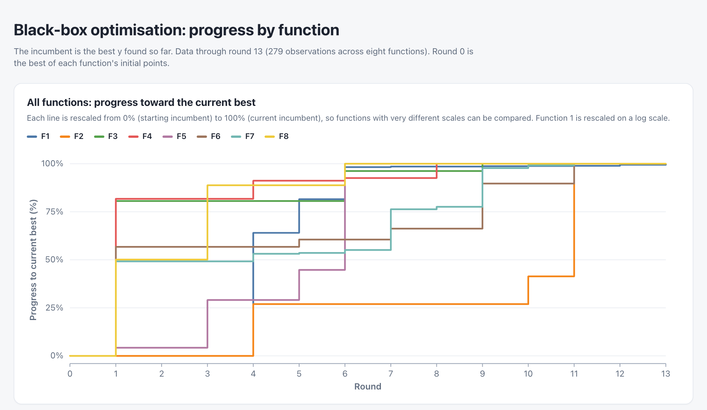

# Model Card for the BBO Optimisation Approach

## 1. Overview

**Approach name:** Function-Specific Surrogate-Assisted Bayesian Optimisation

**Model type:** Sequential black-box optimisation using probabilistic surrogate models and alternative regression approaches.

**Version:** Final (after round 13)

**Primary tools:** Python, Jupyter, scikit-learn, PyTorch and GPyTorch, NumPy, Pandas and SciPy, with selective LLM-assisted coding and analysis.

The approach is not a single fixed model. It is a framework for selecting and refining optimisation methods according to the observed characteristics of each function, recognising their highly idiosyncratic behaviour.

## 2. Model Description

**Input.** For each function, the data are the observations collected so far: an array of inputs X with one row per query and one column per dimension (2 to 8, each scaled to [0, 1]), and a vector y of scalar outputs. Each function started with 10 to 40 initial observations and gained one per weekly round (23 to 53 by round 13). The data are in [`data/`](data/) and described in [`DATASHEET.md`](DATASHEET.md).

**Output.** One new query per function per round: a point in [0, 1]^d to evaluate next, submitted as hyphen-separated values to six decimal places. The surrogate models also produce predicted means and uncertainties used to rank candidates.

**Model architecture.** There is no single model. Each function has its own notebook (`notebooks/f1.ipynb` to `f8.ipynb`) combining:

| Function | Main surrogate and search |
|----------|---------------------------|
| F1 | Local GP (RBF, one length scale per input) on a signed-log target, with a quadratic along the trajectory and directional probes |
| F2 | GP (Matérn 3/2, ARD) with a fixed noise floor; EI, PI, UCB and posterior mean on a grid, local refinement |
| F3 | Two GPs (RBF and Matérn 3/2) on a Yeo-Johnson target, ranked by consensus across four criteria |
| F4 | GP (Matérn 3/2, ARD) with a neural-network ensemble and a TuRBO trust-region cross-check |
| F5 | Raw and log1p GPs (Matérn 5/2, ARD) with a conditional local search |
| F6 | GP, then TuRBO-1 (Matérn 5/2 with fitted noise), with a walk-forward calibration check |
| F7 | Raw and log GPs, then TuRBO-1 on GPyTorch (Matérn 5/2, ARD), with quadratic interpolation |
| F8 | GP and neural-network consensus search (weeks 1 to 5), then ordinary least-squares quadratic regression with an analytic optimum |

The common acquisition functions are expected improvement (EI), probability of improvement (PI), upper confidence bound (UCB) and posterior mean. Final queries were chosen by the analyst from these rankings, not by an automatic rule.

## 3. Intended Use

The approach is designed for maximising expensive-to-evaluate black-box functions where the underlying mathematical relationships and gradients are unknown.

It is particularly relevant where:

- Evaluation budgets are limited.
- The number of observations is relatively small.
- Functions have different dimensionalities and structural characteristics.
- Decisions must balance exploration and exploitation.

The approach is less suitable where the underlying functions are highly discontinuous, observations are too sparse to support reliable surrogate modelling, or model uncertainty is poorly calibrated.

It should not be applied automatically to real-world optimisation problems without assessing the relevant assumptions and constraints.

## 4. Optimisation Strategy and Evolution

The methodology evolved considerably across the 13 rounds.

### Initial approach
The initial strategy was largely exploratory and heuristic. The observations were examined to identify promising regions and infer relationships between inputs and outputs.

Although this produced some improvements, it was difficult to assess uncertainty or determine whether a particular query was genuinely preferable to alternatives.

### Introduction of Gaussian Processes and Bayesian optimisation
GP surrogate models were subsequently introduced, principally using scikit-learn.

These allowed estimation of the underlying functions and generation of predictions for unobserved coordinates. The methodology included experimentation with alternative kernels, hyperparameter optimisation and acquisition functions. The main advantage was the ability to combine predicted performance with an estimate of uncertainty.

However, sophisticated models could fit the observed data without necessarily producing better queries.

### Function-specific modelling
As the challenge progressed, it became clear that the eight functions were highly idiosyncratic.

- **F1:** Extreme variation in output magnitude (over 120 orders of magnitude), requiring careful local modelling.
- **F2:** Multiple promising regions and limitations in GP predictive performance.
- **F3:** Apparent observation noise, complicating model fitting and validation.
- **F4:** Substantial improvements but considerable sensitivity to selected coordinates.
- **F5:** Strong directional and boundary-related behaviour.
- **F6:** A balance between local refinement and the possibility of better regions elsewhere.
- **F7:** Successive improvements through local refinements, particularly in later rounds.
- **F8:** Regression on an assumed quadratic form (from round 6) proved far more useful than increasingly complex GP specifications; the function was recovered exactly.

### Validation and LLM-assisted analysis
Model diagnostics and out-of-sample validation, particularly leave-one-out cross-validation (LOOCV) and, for F6, a walk-forward calibration check, were increasingly used to compare modelling approaches.

LLMs were used selectively to assist with developing code, interpreting diagnostics, evaluating alternative models and proposing query coordinates. However, LLMs often made basic errors despite successfully performing complex coding or analytical tasks. This led to a more structured approach involving detailed prompts, challenging recommendations and occasionally using one LLM to review another.

The final strategy combined numerical optimisation with LLM-assisted analysis, while retaining the observed data as the principal constraint.

## 5. Performance

The primary performance measure was the maximum observed function output.

For each function, the analysis compared:

- The best observed result from previous rounds.
- The result of the latest query.
- The best result achieved across all observations.

The analysis also considered whether a query improved the incumbent and whether it provided useful information about the underlying function. For surrogate models, relevant diagnostics included prediction errors, LOOCV performance and the consistency of recommendations across alternative specifications.

### Performance across the functions
The methodology increasingly involved selecting an appropriate model for each function rather than applying a universal pipeline. The results included substantial improvements across several functions, although performance was uneven.

### Summary graph
The chart below shows the best value found so far (the incumbent) for each function, normalised to 0 to 100% of its final best, across the 13 rounds. An interactive version is in [`dashboard.html`](dashboard.html).

### Best observed results
The best observed results after Round 13 are:

| Function | Best observed result | Round achieved |
|----------|----------------------|----------------|
| F1 | 4.53 × 10⁻⁶ | 13 |
| F2 | 0.749040 | 11 |
| F3 | −0.007172 | 9 |
| F4 | 0.730826 | 8 |
| F5 | 8662.4825 | 6 |
| F6 | +0.005978 | 11 |
| F7 | 3.283282 | 13 |
| F8 | 10.000000 | 6 |

The function-specific observations are summarised below.

- **F1:** An extremely narrow region of positive outputs. Successive refinements produced incremental gains, with the best result in the final round (12.8% above round 12).
- **F2:** Multiple promising regions and noisy outputs. The best result came in Round 11; rounds 12 and 13 did not beat it.
- **F3:** Noisy, with inconsistent results for identical inputs (−0.0125 and −0.0271 at the same point). The best came in Round 9 and later rounds stayed within the noise.
- **F4:** Sensitive to input coordinates, with the best in Round 8 and no improvement in the five rounds after it.
- **F5:** Boundary-related behaviour; the maximum is at the corner (1, 1, 1, 1) and was reproduced exactly in five rounds.
- **F6:** Noisy; a small positive best in Round 11, followed by weaker results, with a calibration check showing overconfident predictions.
- **F7:** Steady improvements through local refinement, with the best in Round 13 and shrinking gains in the last three rounds.
- **F8:** The maximum of exactly 10 was reached in Round 6 by regression and reproduced in Rounds 10 to 13.

### How performance was measured
- **Optimisation performance.** The primary measure was the maximum observed output per function, judged against the starting best. Because each round supplies one query per function, there is no held-out test set and the results are single runs, not averages.
- **Surrogate accuracy.** Leave-one-out cross-validation on the observations collected at the time (up to round 12), plus a walk-forward check for F6, in which the model is refitted on earlier rounds and scored on the next one.
- **Consistency.** Agreement between model specifications and acquisition functions, and replicated evaluations where available (F3, F5, F8).

### Surrogate accuracy
| Function | Model | Metric (leave-one-out, through round 12) |
|----------|-------|------------------------------------------|
| F2 | GP | RMSE 0.190, MAE 0.121 |
| F3 | GP, Yeo-Johnson, Matérn 3/2 | RMSE 0.0688, R² 0.19, Spearman 0.80 |
| F4 | GP | RMSE 2.70, MAE 1.74, R² 0.925 |
| F4 | Neural-network ensemble | RMSE 1.81, MAE 1.34, R² 0.966 |
| F5 | GP, raw target | RMSE 512.6, MAE 348.0, R² 0.978 |
| F5 | GP, log1p target | RMSE 44.8, MAE 31.6, R² 0.9998 |
| F6 | GP, walk-forward | Standardised errors from −5.1 to +4.0 (rounds 8 to 12), indicating overconfident uncertainty |
| F8 | Quadratic regression | RMSE about 1.7 × 10⁻¹⁵ on 45 rows with 17 coefficients |

F1, F7 and the search stage of F8 were assessed through the incumbent trajectory and local diagnostics, not a single summary metric. The leave-one-out figures are for the observations available at the time, not for the unexplored parts of each domain, so they say little about accuracy far from the sampled points. The F8 fit is an exact, in-sample identification (confirmed by later rounds), not a measure of generalisation to a new function.

## 6. Assumptions and Limitations

### Key assumptions
A central assumption is that the available observations contain sufficient information to infer useful relationships between inputs and outputs. GPs make assumptions about covariance structure and smoothness through their kernels. These assumptions may be inappropriate where functions are highly irregular, non-stationary or where observation noise is not adequately modelled.

Another assumption is that surrogate uncertainty estimates are sufficiently reliable to guide exploration and exploitation. With limited observations, this may not always be the case.

### Main limitations and failure modes
- **Limited observations:** Surrogate models may fit the observed data well while providing misleading predictions in unexplored regions.
- **Sampling bias:** Concentration of queries around promising regions improves local optimisation but reduces coverage of the broader search space.
- **Model complexity:** Additional hyperparameters, transformations and more sophisticated algorithms can improve apparent model fit without improving query performance.
- **Uncertainty calibration:** GP uncertainty estimates may be unreliable when observations are sparse or kernel assumptions are inappropriate.
- **LLM-assisted analysis:** Risks include confirmation bias, inconsistent recommendations and errors that are not immediately apparent.

These limitations increasingly favoured robust, validated approaches over unnecessary model complexity.

## 7. Trade-offs

- **Exploration versus exploitation.** Local refinement produced steady gains (F1, F4, F7) but left most of each domain unexplored, so other optima may exist, particularly for the multimodal and noisy functions (F2, F3, F6).
- **Flexibility versus interpretability.** Function-specific pipelines fit each function but are harder to compare and reuse than a single method. Simple structural models (F8) were both more accurate and easier to interpret than complex GPs.
- **Model complexity versus data.** Richer kernels and transformations improved the fit on the data in hand but not always the next query; with 23 to 53 observations, uncertainty estimates were often overconfident.
- **Noise handling.** Treating a function as noisy avoids chasing favourable draws but slows convergence; treating it as noise-free is faster but risky (F3 and F6 showed the cost of ignoring noise).
- **Speed and cost versus rigour.** Each query took from a few minutes of computation to a full notebook run. Heavier methods (neural-network ensembles, GPyTorch trust regions) add compute and complexity for modest gains.
- **Human judgement versus automation.** Final queries were chosen by the analyst from model rankings, which allowed sanity checks but introduces subjectivity and makes replication harder.
- **LLM assistance versus reliability.** LLMs speeded up coding and analysis but made errors that needed independent checking.

## 8. Ethical Considerations and Transparency

### Real-world adaptation
Although the capstone involves abstract mathematical functions, the underlying issues have direct relevance to real-world decision-making.

For example, in agri-food technology, optimisation may involve biological systems where outcomes are stochastic and decisions have financial, operational or environmental consequences.

In such applications, an optimisation model should not be treated as reliable simply because it produces precise numerical predictions. Understanding uncertainty, documenting assumptions and, importantly, retaining human oversight are essential.

### Reproducibility

**Current documentation**
- Jupyter notebooks contain the datasets, modelling code, diagnostics and visualisations.
- The final code represents the culmination of 13 rounds of iterative development, with function-specific optimisation pipelines. Each notebook reproduces its submitted final query.
- The final models and associated analyses provide a basis for technical reproduction, subject to the availability of the relevant data, dependencies and model settings.

**Limitations**
- Earlier experimental approaches were frequently discarded or superseded.
- Methodological changes and query-selection decisions were not systematically documented across all rounds.
- [`HISTORY.md`](HISTORY.md) records the progression for each function, but the complete decision-making process cannot be reconstructed from the final notebooks alone.

**Assessment**
- The primary objective was to develop effective optimisation approaches rather than preserve a complete record of the learning process.
- Comprehensive documentation of earlier rounds would improve historical transparency but offer limited additional insight into the final models and would cloud understanding of the pipeline.
- Full historical reproducibility would require round-specific model specifications, hyperparameters, validation results and query-selection rationale.
