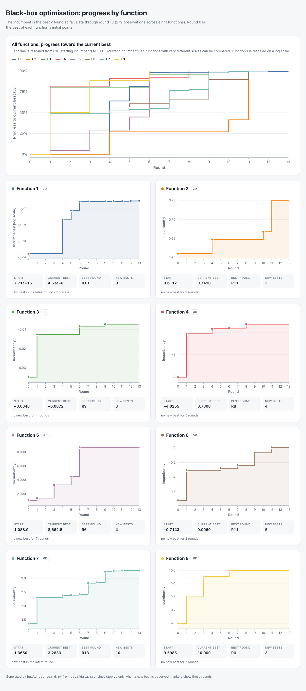

<div align="center">


<h1>Black-Box Optimisation Capstone: October 2026</h1>
<h2>October 2026</h2>

<p><b>Maximising eight unknown functions, from 2 to 8 dimensions, with one query per function per round.</b></p>


[](https://htmlpreview.github.io/?https://github.com/postulix/imperial_bbo_2026/blob/main/dashboard.html)
[](DATASHEET.md)
[](MODEL_CARD.md)
[](HISTORY.md)

[](https://www.linkedin.com/in/vizzone/)
[](https://certificates.emeritus.org/c40021ff-3dff-47fd-851d-7a88d641d7d2?utm_source=youtube&utm_medium=social)

<p>
<a href="#general-approach">Approach</a> &nbsp;·&nbsp;
<a href="#results">Results</a> &nbsp;·&nbsp;
<a href="#dashboard">Dashboard</a> &nbsp;·&nbsp;
<a href="#repository-structure">Structure</a> &nbsp;·&nbsp;
<a href="#getting-started">Getting started</a> &nbsp;·&nbsp;
<a href="#documentation">Documentation</a>
</p>

</div>

---

## Overview

The challenge involved maximising the outputs of eight black-box functions whose underlying equations were unknown. Across 13 rounds, one new set of inputs could be submitted to each function, with a single output returned for each evaluation. With a limited evaluation budget, every query mattered.

The functions presented different challenges, ranging from a near-zero signal spanning more than 100 orders of magnitude, to noisy low-dimensional surfaces, to an eight-dimensional function with a hidden exact mathematical structure. The objective was to find the highest possible output for each function within the available evaluation budget, using the results to inform subsequent queries.

For non-practitioners, A useful way to think about it is investing with incomplete information and a limited budget. Every guess has an opportunity cost, so each round involved a choice between investigating a new opportunity and concentrating on the one that already looked best.

This repository contains the final optimisation pipeline: a consolidated dataset, a notebook for each function, a progress dashboard, and documentation of the methods used, the results obtained, and how the approach evolved throughout the challenge.

## General approach

The following were the main tools used across the functions. More detail for each function is provided in the results below, the notebooks and [`HISTORY.md`](HISTORY.md).

<p align="center"></p>

- **An ensemble approach was generally used:** Several surrogate models (Gaussian processes with different kernels and target transformations, small neural-network ensembles, trust-region models) and several acquisition functions were run side by side, and model agreement was considered when selecting the final query.
- **Gaussian processes:** with ARD kernels (RBF and Matérn), with target transformations (Yeo-Johnson, log, signed-log) where the response spanned orders of magnitude.
- **Acquisition functions:** (posterior mean, EI, PI, UCB) compared against one another, not trusted individually.
- **TuRBO-style trust regions:**, small **neural-network ensembles** and **consensus rankings** as challengers to a single GP.
- **Hyperparameter optimisation:** kernel length scales, noise terms and target transformations were fitted or chosen by cross-validation inside each function's notebook, with the rationale for these choices documented in each function’s notebook (see [`notebooks/`](notebooks/)).
- **Validation before trust:** leave-one-out cross-validation, conditional profiles and walk-forward checks.
- **How it varied by function:** Every function began with a GP and acquisition search. F1 moved to a local GP on a signed-log target, F4 added a neural network and a trust region, and F6 and F7 moved to TuRBO trust regions. F8 started with GP and neural-network search (rounds 1 to 5) and then switched to quadratic regression from round 6, which identified the function exactly.

Throughout most of the challenge, the final query for each function was selected manually after reviewing candidate solutions and diagnostics generated in each notebook. In the final rounds, attempts were made to automate this decision-making process by integrating candidate evaluation and selection into a single pipeline. Errors in the automated workflow led to unreliable recommendations and, in some cases, poorer results.

Changes in approach by round and function are outlined in [`HISTORY.md`](HISTORY.md).

## Results

| Function | Task | Start | Final best | Round | Approach |
|:--|:--|--:|--:|:-:|:--|
| [**F1** · 2D](notebooks/f1.ipynb) | Detect contamination sources | 7.71e−16 | 4.53e−06 | R13 | Local signed-log GP, trajectory analysis |
| [**F2** · 2D](notebooks/f2.ipynb) | Maximise a noisy log-likelihood | 0.611 | 0.749 | R11 | ARD Matérn GP with a fixed noise floor |
| [**F3** · 3D](notebooks/f3.ipynb) | Drug combinations, fewer side effects | −0.0348 | −0.00717 | R9 | Two Yeo-Johnson GPs with consensus ranking |
| [**F4** · 4D](notebooks/f4.ipynb) | Warehouse product placement | −4.03 | 0.731 | R8 | GP, neural network and TuRBO compared |
| [**F5** · 4D](notebooks/f5.ipynb) | Chemical process yield | 1,089 | 8,662.5 | R6 | Log-target GP; optimum on the boundary |
| [**F6** · 5D](notebooks/f6.ipynb) | Cake recipe score | −0.714 | +0.00598 | R11 | TuRBO-1 with a calibration check |
| [**F7** · 6D](notebooks/f7.ipynb) | Tuning an ML model | 1.36 | 3.283 | R13 | TuRBO-1 (GPyTorch), quadratic interpolation |
| [**F8** · 8D](notebooks/f8.ipynb) | Eight-hyperparameter black box | 9.598 | 10.000 | R6 | Quadratic regression recovered the function |

*Start* is the best of the initial observations; *Final best* is the best `y` found by round 13.

### Highlights

**Two functions produced particularly strong results.**

- **Function 8 was effectively maximised.** A separable quadratic with 17 coefficients reproduced every observation to machine precision. The fitted model identified a maximum of 10, reached in round 6 and supported by subsequent evaluations near the optimum; the same value was returned in rounds 10 to 13. A retrospective analysis showed that the same model could have been identified from the initial design alone.
- **Function 5’s seems to be effectively maximised:** of the input range, at (1, 1, 1, 1), with a yield of 8,662.5, nearly double the best seen before round 6. The corner returned the same result in rounds 6 and 10 to 13, although global optimality was not established.

**Capstone presentation.** The project was awarded an *Exemplary Assignment* rating. The [capstone presentation](assets/capstone_presentation.pdf) is also available.

<p align="center">
  <a href="assets/capstone_presentation.pdf">
    
  </a>
</p>

## Dashboard

<p align="center">
  <a href="https://htmlpreview.github.io/?https://github.com/postulix/imperial_bbo_2026/blob/main/dashboard.html">
    
  </a>
</p>

Every function's progress, round by round: the incumbent is the best `y` found so far, and the lines step up only when a new best is observed. The top chart rescales all eight functions from 0% (their starting best) to 100% (their current best) so they can be compared; each function also has its own chart, and Function 1 is drawn on a log scale.

<details>
<summary><b>See all eight functions</b></summary>
<br>
<p align="center"></p>
</details>

> [!NOTE]
> The dashboard opens through an HTML previewer. You can also download `dashboard.html` and open it in any browser. To rebuild it after adding data, run `python build_dashboard.py`.

## Repository structure

```
imperial_bbo_2026/
├── README.md
├── requirements.txt           # Python dependencies for the notebooks and runner
├── HISTORY.md                 # how the search progressed, function by function
├── DATASHEET.md               # documentation of the dataset
├── MODEL_CARD.md              # documentation of the optimisation approach
├── dashboard.html             # progress of the incumbent for all eight functions
├── build_dashboard.py         # regenerates dashboard.html from data/data.csv
├── assets/                    # logos, badge, capstone presentation and dashboard images
├── notebooks/
│   ├── data_handling.ipynb    # builds data/data.csv from the raw initial and per-round data
│   ├── f1.ipynb ... f8.ipynb  # one optimisation notebook per function
│   └── run_all.py             # executes data_handling.ipynb then f1-f8 in order
└── data/
    ├── data.csv               # harmonised dataset read by f1-f8
    ├── initial_data/          # initial inputs and outputs per function (.npy)
    └── new_data/              # each round's submitted inputs and returned outputs
```

## Getting started

```bash
git clone https://github.com/postulix/imperial_bbo_2026.git
cd imperial_bbo_2026
pip install -r requirements.txt
cd notebooks
jupyter lab                    # open any of f1.ipynb ... f8.ipynb
```

Every function notebook follows the same pattern. A **DATA LOADING** cell reads `../data/data.csv` and selects the function, the modelling cells fit surrogate models and search for candidates, and the final cells print the recommended query in the portal's submission format (six decimals, hyphen-separated). Open notebooks from inside `notebooks/`, since paths are relative.

To re-run everything in order and refresh the saved outputs:

```bash
python run_all.py              # from the notebooks/ folder
```

Appending new rows to `data/data.csv` flows through to every notebook on re-run, with no code edits. `data_handling.ipynb` rebuilds the dataset from the raw files.

## Documentation

| Document | What it covers |
|:--|:--|
| [`HISTORY.md`](HISTORY.md) | How each function's search progressed, citing pivotal rounds |
| [`DATASHEET.md`](DATASHEET.md) | The dataset: motivation, composition, how it was collected, preprocessing and known gaps |
| [`MODEL_CARD.md`](MODEL_CARD.md) | The optimisation approach: strategy, performance across the functions, assumptions and limitations |
| [`dashboard.html`](dashboard.html) | Charts of every function's progress, rebuilt from the data |

## The challenge in detail

<details>
<summary><b>What was this challenge about?</b></summary>
<br>

This capstone project was a Black-Box Bayesian optimisation-style competition: find the maximum of eight unknown black-box functions. The equations and shapes of the functions were hidden. Only a small set of initial data and the ability to make informed queries were available.

Each function simulates a real-world task, described below and at the beginning of each notebook, where evaluations are expensive or limited. Perfect solutions were not expected; the aim was to apply sound search strategies and reflect on them as the data grew.

The eight functions are synthetic black boxes: unknown mathematical functions that accept inputs and return a single output. Every function is a **maximisation** problem, with varying dimensionality (2D to 8D), and each began with a set of known (x, y) observations of a differing number of observations.

In each round:

1. The existing data was reviewed (it grew by one point per function each round).
2. A new input (x) was chosen for each function.
3. The input was submitted through the capstone project portal in the correct format.
4. The new output (y) was returned once the submission was processed.
5. The dataset was updated and the strategy revised.
6. Each round was followed by a reflection on the method used and why, whether the query was exploration or exploitation, what the latest result showed, and the strategy for the next round.

The process ran for 13 rounds, so each function ends with its initial observations plus 13 queried points. Any ML method could be used to decide each query. The search used Gaussian-process-based Bayesian optimisation for most functions, with TuRBO trust regions, neural-network cross-checks and, for Function 8, quadratic regression. The task did not require submitting an optimiser, building a full optimisation model from scratch, or finding the global maximum of every function.

</details>

<details>
<summary><b>Function shapes</b></summary>
<br>

Observations per function: initial (round 0) and final (after 13 rounds).

| Function | Inputs | Initial points | Final points |
|:-:|:-:|:-:|:-:|
| 1 | 2 | 10 | 23 |
| 2 | 2 | 10 | 23 |
| 3 | 3 | 15 | 28 |
| 4 | 4 | 30 | 43 |
| 5 | 4 | 20 | 33 |
| 6 | 5 | 20 | 33 |
| 7 | 6 | 30 | 43 |
| 8 | 8 | 40 | 53 |

</details>

<details>
<summary><b>Function descriptions</b></summary>
<br>
The descriptions below are reproduced from the original challenge materials. They are illustrative and do not necessarily describe the observed output ranges or final results.


**Function 1:** Detect likely contamination sources in a two-dimensional area, such as a radiation field, where only proximity yields a non-zero reading. The system uses Bayesian optimisation to tune detection parameters and reliably identify both strong and weak sources.

**Function 2:** Imagine a black box, or a mystery ML model, that takes two numbers as input and returns a log-likelihood score. Your goal is to maximise that score, but each output is noisy, and depending on where you start, you might get stuck in a local optimum. To tackle this, you use Bayesian optimisation, which selects the next inputs based on what it has learned so far. It balances exploration with exploitation, making it well suited to noisy outputs and complex functions with many local peaks.

**Function 3:** You’re working on a drug discovery project, testing combinations of three compounds to create a new medicine. Each experiment is stored in initial_inputs.npy as a 3D array, where each row lists the amounts of the three compounds used. After each experiment, you record the number of adverse reactions, stored in initial_outputs.npy as a 1D array. Your goal is to minimise side effects; in this competition, it is framed as maximisation by optimising a transformed output (e.g. the negative of side effects).

**Function 4:** Address the challenge of optimally placing products across warehouses for a business with high online sales, where accurate calculations are costly and only feasible biweekly. To speed up decision-making, an ML model approximates these results within hours. The model has four hyperparameters to tune, and its output reflects the difference from the expensive baseline. Because the system is dynamic and full of local optima, it requires careful tuning and robust validation to find reliable, near-optimal solutions.

**Function 5:** You’re tasked with optimising a four-variable black-box function that represents the yield of a chemical process in a factory. The function is typically unimodal, with a single peak where yield is maximised. Your goal is to find the optimal combination of chemical inputs that delivers the highest possible yield, using systematic exploration and optimisation methods.

**Function 6:** You’re optimising a cake recipe using a black-box function with five ingredient inputs, for example flour, sugar, eggs, butter and milk. Each recipe is evaluated with a combined score based on flavour, consistency, calories, waste and cost, where each factor contributes negative points as judged by an expert taster. This means the total score is negative by design. To frame this as a maximisation problem, your goal is to bring that score as close to zero as possible or, equivalently, to maximise the negative of the total sum.

**Function 7:** You’re tasked with optimising an ML model by tuning six hyperparameters, for example learning rate, regularisation strength or number of hidden layers. The function you’re maximising is the model’s performance score (such as accuracy or F1), but since the relationship between inputs and output isn’t known, it’s treated as a black-box function. Because this is a commonly used model, you might benefit from researching best practices or literature to guide your initial search space. Your goal is to find the combination of hyperparameters that yields the highest possible performance.

**Function 8:** You’re optimising an eight-dimensional black-box function, where each of the eight input parameters affects the output, but the internal mechanics are unknown. Your objective is to find the parameter combination that maximises the function’s output, such as performance, efficiency or validation accuracy. Because the function is high-dimensional and likely complex, global optimisation is hard, so identifying strong local maxima is often a practical strategy. For example, imagine you’re tuning an ML model with eight hyperparameters: learning rate, batch size, number of layers, dropout rate, regularisation strength, activation function (numerically encoded), optimiser type (encoded) and initial weight range. Each input set returns a single validation accuracy score between 0 and 1. Your goal is to maximise this score.

</details>

## Licence

Code is released under the MIT licence; data and documentation under [CC BY 4.0](https://creativecommons.org/licenses/by/4.0/), so reuse needs only attribution (see [`LICENSE`](LICENSE)). The black-box functions and their descriptions come from the Imperial College Business School Executive Education programme (with Emeritus), and this repository is shared for educational and portfolio use.
